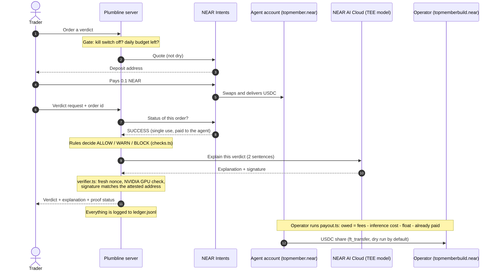

<p></p>

**Check the quote before you sign.**

Plumbline is a small autonomous business for NEAR Intents traders. Before you sign a swap, you pay a few cents to Plumbline and get a verdict on the quote: **ALLOW**, **WARN** or **BLOCK**. Plain rules decide the verdict. An AI model only explains it, and it runs inside a NEAR AI Cloud secure enclave whose signature and GPU attestation Plumbline checks on every verdict.

Built for **NEAR HACKATHON** (tracks: Autonomous Business, AI Security & Defense, Agent Economy). Solo project.



## The problem

A swap quote can look fine and still hand you much less value than you put in, especially on thin tokens or tiny trades where fixed fees dominate. Wallets show the quote, not a judgement of it. A trader who wants a second opinion before signing has no cheap, checkable way to get one.

## What it does

1. The trader picks a swap and orders a verdict. Plumbline refuses if the operator's **kill switch** is on or the **daily inference budget** is spent.
2. Plumbline creates a NEAR Intents order. The trader pays **0.1 NEAR** (about $0.40 at the time of the recorded run) and Intents delivers USDC to the agent account `topmember.near`.
3. The verdict is released only after Intents reports the order as `SUCCESS`, paid to the agent, and not used before.
4. `checks.ts` decides ALLOW, WARN or BLOCK from the quote's USD in and out values. **The AI cannot change the verdict.**
5. The NEAR AI Cloud model writes a two-sentence explanation. `verifier.ts` checks the enclave proof (see "What is verified").
6. Every order, verdict, refusal and payout is written to `ledger.jsonl`.
7. `payout.ts` sends the operator's share of the USDC to `topmemberbuild.near`.

## Try it

Developed and tested on Node 26 (Windows). The commands are the same in Windows cmd, macOS and Linux.

### A. No keys needed: the rules engine

```
npm install
npm run checks -- fixtures/demo-allow.json
npm run checks -- fixtures/demo-warn.json
npm run checks -- fixtures/demo-block.json
```

**See:** each command prints its checks and ends with `VERDICT: ALLOW`, `VERDICT: WARN` or `VERDICT: BLOCK`. The three files are frozen real dry quotes from the NEAR Intents 1Click API, so the output is the same every time. `npm run checks -- your-quote.json` works on any 1Click quote JSON.

### B. No keys needed: the web page

```
npm start
```

Open http://127.0.0.1:3000 and click one of the three frozen quotes.

**See:** a plumb bob that swings, then comes to rest over the Allow, Warn or Block zone, with the numbers behind the verdict and a row in the field book (the ledger). Without an AI key the explanation is built from the checks, and the page says "No enclave attestation for this verdict." By default `requireFee` is `false`, so no payment is asked for (demo mode). The page says so.

### B2. Live swaps (no secrets, but two addresses)

Put any NEAR account in `REFUND_TO` and any `0x` address in `RECIPIENT` in `.env`, then restart `npm start`. The swap form appears above the instrument.

**See:** pick a NEAR-chain token, an amount in USD, and a destination token on NEAR or an EVM chain, then press Get verdict. Plumbline asks NEAR Intents for a live dry quote and judges it. Nothing is swapped and no funds move; the two addresses are only used to make the quote request valid. In paid mode the quote is fetched before anyone is asked to pay, so a pair with no quote never takes a payment.

### C. With a NEAR AI Cloud key: check the enclave proof

Copy `.env.example` to `.env` and set `NEAR_AI_API_KEY` (from https://cloud.near.ai), then:

```
npm run verify
```

**See:** `[PASS]` lines for the fresh nonce, the NVIDIA GPU attestation and the response signature, then `RESULT: verified`. It also prints `[NOT DONE] Intel TDX quote`, which is a known gap (below). The exit code is 0 only if everything that is checked passed.

With the key set, `npm start` verdicts show: "Explanation signature and GPU attestation checked. Signer 0x... The Intel CPU quote is not checked yet."

### D. Paid mode (real mainnet money, small amounts)

NEAR Intents has no testnet, so this uses mainnet with tiny amounts. Set `AGENT_ACCOUNT` and `REFUND_TO` in `.env`, copy `config.example.json` to `config.json`, set `"requireFee": true`, and run `npm start`.

**See:** the page shows a deposit address and waits. After you send 0.1 NEAR to it, the page polls Intents; the verdict appears after `SUCCESS`, and the ledger row shows `feeVerified: true` with the Intents transaction hash.

### E. Revenue split

```
npm run payout
```

**See:** a dry run listing verified fees, inference cost, the float kept by the agent, anything already paid out, what is owed, and what would be sent. Nothing is sent. `npm run payout -- --send` sends it (needs `AGENT_PRIVATE_KEY` in `.env` and a little NEAR in the agent account for gas) and records a `payout` line with the transaction hash.

The split of each verified fee: real inference cost first, then a float that stays in the agent account (`floatPct`, default 20%), and the rest to `payoutAccount` (`topmemberbuild.near`).

## Evidence from a real run

`evidence/ledger.jsonl` is the ledger from the recorded mainnet run: paid verdicts with Intents transaction hashes, `attestationVerified: true` rows, and the payout with its transaction hash. The accounts involved are `topmember.near` (agent) and `topmemberbuild.near` (operator and payout account).

One mistake is in that ledger on purpose. During a payout, a network error (`ECONNRESET`) ended the script after the transfer had already gone through, so nothing was logged, and a second `--send` then paid out the agent's remaining balance, which used up the float. Both transfers are on chain; one was added to the ledger by hand with `--resolve`. `payout.ts` was changed afterwards: it writes an intent line first, checks the balance after any error, blocks further sending until an uncertain attempt is resolved, and refuses to send when the balance is lower than what is owed.

## What is verified, and what is not

Each AI explanation is checked like this (`verifier.ts`, ported from NEAR's official verification example):

- a fresh random nonce is sent and must be echoed by the gateway and the model's enclave;
- NVIDIA's attestation service must accept the model host's GPUs (overall result, nonce, secure boot on, debug off, on every GPU);
- the request and response hashes in NEAR's signature must match the exact bytes sent and received;
- the signature must recover to a signing address listed in the attestation report.

**Not checked** (Plumbline says so on the page and in `npm run verify`):

- the Intel TDX quote, the CPU-side proof;
- the signatures on NVIDIA's result tokens (they are decoded, as in NEAR's example).

So the claim is "signature and GPU attestation checked", not "fully verified".

Other limits, stated plainly:

- The web demo checks the **three frozen quotes**, or a **live dry quote** for any pair its builder offers. Origin tokens are NEAR-chain tokens; destinations are tokens on NEAR and the EVM chains in `server.ts`. Other chains are not offered yet. The rules engine itself takes any 1Click quote (`npm run checks -- file.json`).
- Rules are simple: price deviation from the quote's own USD values, with a tiny-trade guard. Thresholds are in `checks.ts` (WARN above 1% loss, BLOCK above 3%) and were tuned by hand on a few quotes. A verdict says what the quote implies, not what you will lose.
- Inference cost uses per-million-token prices from `config.json`. They came from a third-party price page and should be confirmed at cloud.near.ai.
- The server listens on `127.0.0.1` only unless you set `HOST`. On a public host, set `OPERATOR_TOKEN`: the kill switch then needs that token, and without it the switch is disabled. The agent's private key (`AGENT_PRIVATE_KEY`) is only used by `payout.ts` on the operator's own machine and is never needed on the server.

## Safety controls (the human sets the limits)

- **Kill switch:** the operator toggle on the page (or `"killSwitch": true` in `config.json`) makes Plumbline refuse new orders and verdicts. Refusals are logged.
- **Daily inference budget:** `dailyInferenceBudgetUsd` stops sales once the day's real inference cost reaches it.
- **Single-use payments:** one order, one verdict. The recipient must be the agent account.
- **Dry-run payouts:** `payout.ts` never sends without `--send`, and never sends more than the ledger says is owed or the agent's balance.

## Project layout

| File | What it is |
| --- | --- |
| `checks.ts` | Rules engine: decides ALLOW, WARN or BLOCK |
| `server.ts` | HTTP server: orders, payment check, verdicts, ledger, kill switch |
| `verifier.ts` | Calls NEAR AI Cloud and checks the attestation and signature |
| `verify-cli.ts` | `npm run verify` |
| `payout.ts` | Revenue split and USDC payout |
| `public/index.html` | The web page: swap form, plumb bob instrument, field book, operator switch |
| `assets/` | Logo (SVG and PNG) |
| `demo-fixtures.ts` | Saves the three frozen demo quotes (needs `.env`) |
| `proof.ts`, `fee-*.ts`, `probe.ts`, `tokens.ts` | Early runtime-proof and fee-test scripts |
| `docs/architecture.*` | Architecture diagram (Mermaid source, SVG, PNG) |
| `evidence/` | Ledger from the recorded mainnet run |

## Built with

- TypeScript on Node, run with `tsx`; plain `node:http` server.
- Libraries: `dotenv`, `openai` (early proof script), `ethers` (signature recovery), `jose` (decoding NVIDIA tokens), `near-api-js` (payout).
- Services: NEAR Intents 1Click API, NEAR AI Cloud, NVIDIA remote attestation service.
- Verification logic follows NEAR's official example: near-examples/nearai-cloud-verification-example.

## Disclosures

- **New work:** all code in this repository was written during the hackathon period (November 2026). There is no pre-hackathon code and no existing product on another chain.
- **AI-generated code:** most of the code was written with Claude (Anthropic) as an AI coding assistant, directed, run and tested by the author on real NEAR mainnet accounts.
- **Other projects:** this is the author's only NEAR HACKATHON submission.

## License

MIT. See `LICENSE`.
